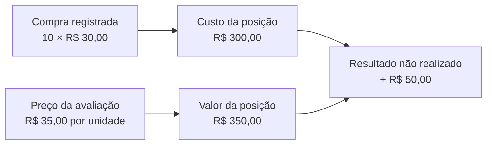
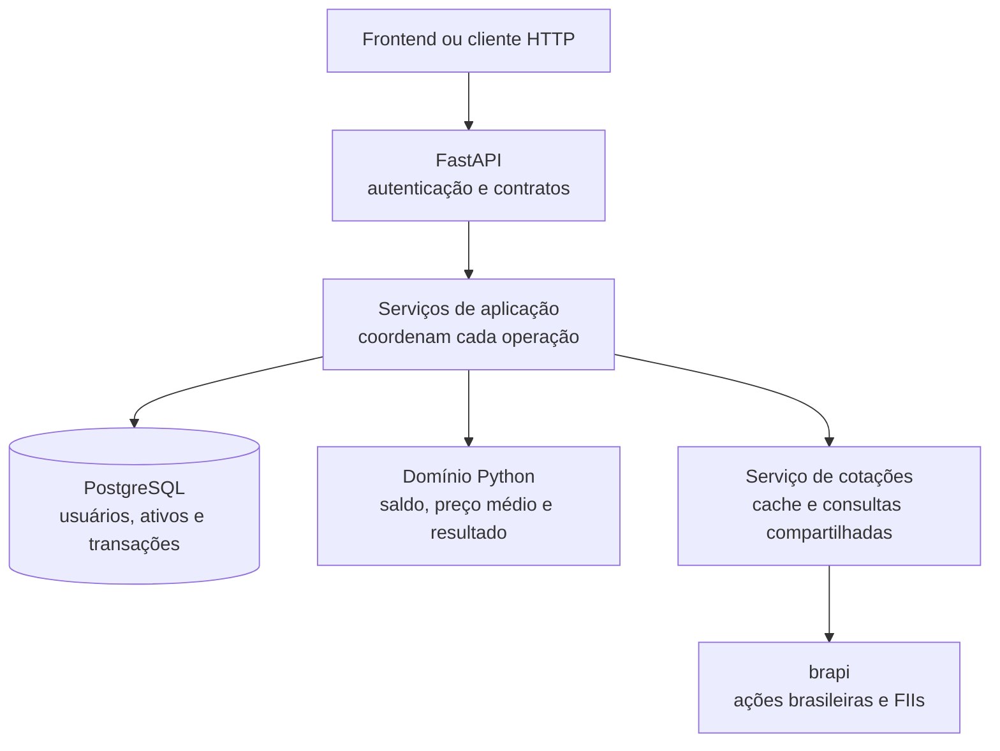

<h1 align="center">FinTrack</h1>

<p align="center">
  <strong>Do histórico de investimentos a uma visão clara da carteira.</strong><br>
  API para registrar compras e vendas, acompanhar posições e avaliar patrimônio por moeda.
</p>

<p align="center">
  
  
  
  <a href="LICENSE"></a>
</p>

<p align="center">
  <a href="https://fintrack-ye2t.onrender.com/docs">API publicada</a> ·
  <a href="#comece-por-aqui">Executar localmente</a> ·
  <a href="docs/api.md">Contratos da API</a> ·
  <a href="CONTRIBUTING.md">Contribuir</a>
</p>

> **Estado da entrega:** a versão anterior já está publicada no Render e atende um frontend existente. Esta atualização implementa persistência assíncrona e avaliação v2 com cotações. O frontend pode continuar nas rotas atuais e adotar a v2 depois. O Swagger do ambiente publicado representa a versão implantada, que pode diferir desta branch.

## O que o projeto faz

O FinTrack organiza o que uma pessoa comprou, vendeu e ainda possui. A partir desse histórico, calcula quantidade, preço médio, custo da posição e resultado em relação ao preço usado na avaliação.

| Você quer saber… | O FinTrack entrega |
|---|---|
| Quais investimentos ainda tenho? | Posições abertas reconstruídas a partir das compras e vendas. |
| Quanto paguei pelas unidades que mantenho? | Quantidade, preço médio e custo da posição. |
| Quanto essa posição vale na avaliação? | Quantidade × cotação de mercado ou preço cadastrado identificado. |
| Qual é a diferença em relação ao custo? | P&L: lucro ou prejuízo **não realizado** das posições abertas. |
| Tenho investimentos em moedas diferentes? | Totais separados por moeda, sem somar reais e dólares. |

O catálogo comporta ações brasileiras e internacionais, fundos imobiliários (FIIs), criptomoedas, CDBs e títulos públicos. **Cotações externas estão disponíveis nesta versão para ações brasileiras e FIIs configurados na brapi.** Os demais ativos usam avaliação manual, com moeda definida.

## Entenda com um exemplo

Uma compra fictícia de **10 unidades a R$ 30,00** tem custo de **R$ 300,00**. Se o preço usado na avaliação for **R$ 35,00**, a posição vale **R$ 350,00**: diferença de **R$ 50,00**, aproximadamente **16,67%**.



O preço original da compra permanece no histórico. Uma cotação nova muda a avaliação, não reescreve a transação.

| Conceito | Significado no projeto |
|---|---|
| **Preço da transação** | Valor informado em uma compra ou venda. |
| **Preço cadastrado** | Referência manual armazenada no catálogo do ativo. |
| **Cotação** | Preço obtido do provedor, acompanhado de fonte, moeda e horários. |
| **Posição** | Quantidade de um ativo que ainda permanece na carteira. |
| **Cache** | Reutilização temporária de uma cotação para evitar consultas externas repetidas. |

As leituras atuais usam preços cadastrados. As leituras v2 usam a fonte configurada e informam quando a avaliação é manual. Cotações podem ter atraso e ser reutilizadas do cache; o projeto não promete preços em tempo real.

## Comece por aqui

Requisitos: Git, Docker e Docker Compose. A porta 8000 deve estar disponível; o Compose de desenvolvimento também publica o PostgreSQL na porta 5432.

```bash
git clone https://github.com/Victor-TelesF/fintrack.git
cd fintrack
cp .env.example .env
```

Edite `.env`: defina as chaves de autenticação/administração e as credenciais locais do banco. No Compose, mantenha `POSTGRES_HOST=db`. `BRAPI_TOKEN` pode ficar vazio para explorar os fluxos legados e avaliações manuais; para consultar mercado, use a chave da brapi **sem** o prefixo `Bearer`.

```bash
docker compose up --build
```

Abra [localhost:8000/docs](http://localhost:8000/docs). O Compose executa a release de migrations antes da API; iniciar a API diretamente exige uma release anterior. Consulte [operação](docs/operacao.md) para PostgreSQL externo, TLS e healthchecks.

Para experimentar no Swagger local:

1. Cadastre um usuário em `POST /auth/register` e faça login em `POST /auth/login`.
2. Use o `access_token` como `Authorization: Bearer <token>` nas chamadas autenticadas. O login recebe JSON; veja o [exemplo com curl](docs/api.md#autenticação).
3. Cadastre ativos em `POST /admin/assets`, enviando a chave local no header `X-Admin-Key`.
4. Registre uma compra e consulte posições, histórico e resumo.

Use dados fictícios no ambiente de demonstração. A chave administrativa pertence ao operador do backend.

<details>
<summary><strong>Executar com Python e uv</strong></summary>

Com Python 3.13, uv e PostgreSQL disponíveis, configure `.env` com o host acessível pelo seu terminal — normalmente `localhost`, quando o banco roda localmente.

```bash
uv sync --locked
uv run --locked alembic upgrade head
uv run --locked uvicorn app.main:app --reload
```

As dependências são definidas em `pyproject.toml` e fixadas em `uv.lock`. Para adicionar uma biblioteca, use `uv add`; para ferramentas de desenvolvimento, `uv add --dev`.

</details>

## API e compatibilidade

| Fluxo | Rotas principais | Acesso |
|---|---|---|
| Conta | `POST /auth/register`, `POST /auth/login` | Público, com limite de requisições |
| Catálogo | `GET /assets`, `GET /assets/{asset_id}` | JWT |
| Administração | `POST /admin/assets` | `X-Admin-Key` |
| Operações | `POST /portfolios/buy`, `POST /portfolios/sell` | JWT |
| Histórico | `GET /portfolios/transactions` | JWT |
| Avaliação atual | `GET /portfolios/positions`, `GET /portfolios/summary` | JWT; preço cadastrado |
| Avaliação v2 | `GET /api/v2/portfolios/positions`, `GET /api/v2/portfolios/summary` | JWT; fonte e totais por moeda |

Valores monetários são serializados como strings decimais. As respostas v2 distinguem preço cadastrado de cotação, identificam avaliações manuais e incluem os preços usados nos totais. Falhas de configuração ou de cotação retornam erros explícitos, sem apresentar totais parciais como completos.

Consulte [exemplos, campos e erros](docs/api.md) e o [roteiro de atualização do backend e frontend](docs/operacao.md).

## Como funciona por dentro



| Decisão | Benefício |
|---|---|
| Domínio independente de FastAPI e SQLAlchemy | Regras financeiras podem ser testadas sem banco ou servidor. |
| `Decimal` nos cálculos | Evita usar ponto flutuante binário como representação dos valores financeiros. |
| SQLAlchemy async e HTTPX | I/O de banco e provedor assíncrono; cálculos do domínio permanecem síncronos. |
| Histórico como origem das posições | Quantidade e preço médio são reconstruídos a partir das transações. |
| Lock por carteira nas operações | Serializa escritas concorrentes para proteger o saldo disponível. |
| Cache limitado e deduplicação de buscas | Reduz chamadas repetidas ao provedor dentro do mesmo processo. |
| Migrations Alembic e `uv.lock` | Versiona o schema e fixa as dependências da aplicação. |

```text
app/          API, autenticação, persistência e integração de cotações
domain/       ativos, carteira, transações e estratégias de cálculo
alembic/      evolução do banco de dados
tests/        domínio, contratos HTTP, integração, migrations e cotações
scripts/      verificações controladas da integração e da imagem
docs/         contratos e operação
```

## Qualidade e limites

Na validação local de **01/10/2026**, **324 testes passaram** com PostgreSQL 15. A suíte cobre regras de domínio, compatibilidade HTTP, rollback, concorrência, migrations, cache e falhas de cotações simuladas. O CI contém um job de testes e outro para a imagem de produção, com fluxo HTTP e encerramento gracioso. Esse resultado local não representa uma execução remota do workflow.

```bash
uv run --locked pytest tests/domain -q
```

Para executar a suíte completa, use **um banco exclusivo de testes**: as fixtures criam e removem tabelas. Veja [como validar e contribuir](CONTRIBUTING.md).

Limites desta versão:

- P&L cobre posições abertas; não inclui dividendos, lucro realizado ou impostos.
- Não há conversão cambial nem total que misture moedas.
- Cotações externas não cobrem cripto, ações internacionais ou renda fixa nesta entrega. As estratégias de renda fixa do domínio não equivalem a uma atualização automática do valor desses ativos na API.
- Ativos antigos podem precisar de revisão de moeda e mapeamento antes de usar as leituras v2.
- Cache e limites de requisições são locais ao processo; a configuração inicial considera uma réplica.

## Documentação e contribuição

- [Contratos da API](docs/api.md): autenticação, cadastro, compra, avaliação e erros.
- [Operação e atualização](docs/operacao.md): configuração, Render, migrations, frontend e retorno.
- [Guia de contribuição](CONTRIBUTING.md): testes, microcommits e o que deve entrar no GitHub.
- [Pesquisa de mercado e primeira compra](docs/plans/market-discovery/plan.md): etapas 0–1 concluídas; configuração/release preparadas, descoberta e primeira compra pendentes.

Desenvolvido por [Victor Teles](https://github.com/Victor-TelesF). Distribuído sob a [licença MIT](LICENSE).
