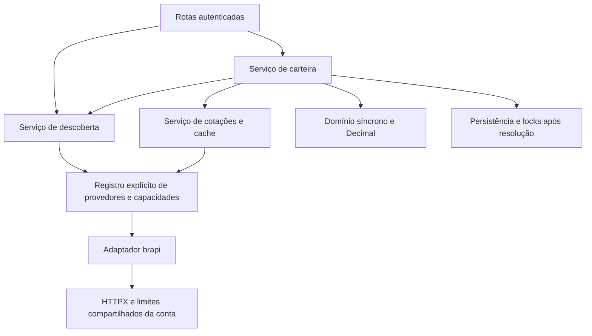

# Pesquisa de mercado e cadastro na primeira compra

Data: 02/10/2026. Estado: **etapas 0, 1, 2a e 2b concluídas; etapa 3a pendente de autorização**. Etapa 1 validada com PostgreSQL TLS descartável e runtime sem dev; imagem/Compose em execução e infraestrutura externa continuam pendentes.

Branch de trabalho: **`refactor/market-discovery`**, criada após o planejamento por solicitação do usuário, a partir de `feature/v2-async-prices` em `80a6af7`. Alterações documentais preservadas sem commit. A base de inspeção abaixo permanece histórica.

Comece pelo [handoff](handoff.md). O [contrato HTTP](api-contract.md) define a entrega pretendida; o [progresso](progress.md) separa evidências atuais de resultados históricos. Este trabalho sucede a v2 async/preços já implementada, sem substituir seu plano ou repetir suas etapas.

## Objetivo e decisões

Permitir pesquisar ações brasileiras e FIIs com banco vazio e cadastrar o ativo validado na primeira compra. Após verificar esse fluxo, remover a administração manual do catálogo. Preparar execução em Docker com PostgreSQL externo e documentar o futuro deploy EC2/RDS/ECR/GitHub Actions, mantendo o frontend na Vercel.

Decisões do usuário na etapa 0, preservadas na etapa 1:

- Manter os provedores gratuitos. Usar brapi para ações brasileiras e FIIs.
- A preferência inicial por cripto na brapi foi revista após duas respostas reais 403: **criptomoedas ficam pendentes de uma fonte gratuita**. Não contratar plano pago nem integrar CoinGecko nesta entrega.
- Preparar interfaces para outras fontes, mantendo regras financeiras independentes do provedor.
- Executar uma etapa por conversa, com parada e atualização documental. A etapa 0 limitou-se a inspeção e planejamento. Em 02/10/2026, o usuário autorizou somente a etapa 1, sem commit, push, deploy ou provisão AWS; depois autorizou as etapas 2a e 2b separadamente. O pedido posterior para fazer micro commits autoriza registrar localmente apenas as mudanças já concluídas; não autoriza a etapa 3a, push, deploy ou AWS.

Preservar domínio síncrono, `Decimal`, IDs e histórico existentes, preço informado da operação, isolamento de usuários, ativos antigos e as duas leituras v2. Sem conversão cambial automática. Cripto antiga continua negociável quando já cadastrada; sua moeda e origem não podem ser inferidas retroativamente.

Não entram: novo provedor real, pesquisa/primeiro cadastro de cripto, ações internacionais de mercado, ETFs, BDRs, units, outros fundos, renda fixa nova, histórico de cotações, scheduler, Redis, frontend, provisão AWS, permissões da conta, deploy ou dados de produção.

## Inspeção inicial do código — etapa 0

Base conferida: branch `feature/v2-async-prices`, HEAD `80a6af7`. Árvore limpa antes desta etapa. Os commits `7c0d35e`, `4500ecb`, `bcfd491`, `29a98dd`, `9291f24` e `e791bdd` já contêm adaptador, cache, metadados, carteira async, leituras v2 e validação da imagem. O registro antigo ainda descrevia HEAD `fcfd48b` e alterações sem commit; isso é evidência histórica, superada pela inspeção atual.

| Arquivos | Evidência atual e consequência |
|---|---|
| `app/price_sources/types.py`, `cache.py` | Contrato `AsyncPriceSource`, cotação normalizada e chave por fonte/ID/moeda existem; reutilizar. |
| `app/price_sources/brapi_source.py` | Somente `/api/v2/stocks/quote`; Decimal, timestamps, lotes, semáforo e cooldown 429 existentes. Não há descoberta nem cripto. |
| `app/service/quote_service.py`, `asset_service.py`, `portfolio_service.py` | Regras de fonte/tipo/moeda ainda fixam brapi/BRL; trocar por capacidades do provedor, sem mudar cálculos. |
| `app/schemas/asset_schema.py` | Origem limitada a `manual`/`brapi`; futura fonte exige ajuste de schema e registro, não alteração do domínio. |
| `app/models/asset_model.py`, `alembic/versions/` | Ticker **não tem unicidade** no modelo/migrations; busca com `scalar_one_or_none()` pressupõe unicidade. Metadados anuláveis desde `9d2a6c4e8f10`; nome limitado a 50 caracteres. |
| `app/service/portfolio_service.py` | Compra/venda exigem ativo local; lock da carteira ocorre antes da busca do ativo. Resolução HTTP deverá ocorrer antes dos locks de escrita. |
| `app/routers/asset_router.py`, `admin_router.py` | Só catálogo local e POST administrativo; registrar novas rotas estáticas antes de `/{asset_id}`. |
| `app/config.py`, `database.py`, `alembic/env.py` | PostgreSQL por componentes; URL concatenada, sem suporte a `DATABASE_URL`, TLS/pool sem configuração explícita. Alembic síncrono usa o mesmo psycopg; não migrar novamente toda a aplicação para async. |
| `app/main.py`, `app/dependencies.py` | Sessões async e lifespan já encerram serviço/HTTP/engine; preservar e incluir recursos novos. |
| `Dockerfile`, `start.sh`, Compose | Imagem não-root, dependências sem dev; entrypoint migra a cada processo. Healthcheck consulta OpenAPI, sem readiness de banco. Separar release e API. |
| `.github/workflows/ci.yml`, `scripts/check_release.py` | CI testa PostgreSQL e imagem; fluxo de imagem/testes depende de admin e migrations no entrypoint. Atualizar nas etapas correspondentes. Não há workflow AWS ativo. |
| `tests/app/conftest.py`, `tests/prices/`, `tests/contracts/` | HTTPX/lifespan, testes PostgreSQL e respostas simuladas existem. Fixtures HTTP criam/removem tabelas: executar só em banco descartável. Baselines legados preservados. |

## Contrato externo conferido

Consultadas documentação oficial e OpenAPI em 02/10/2026. São fontes do contrato, não prova de cobertura de todos os instrumentos.

- [Tickers v2](https://brapi.dev/docs/tickers): `/api/v2/tickers` traz nome, `assetType`, `subType`, moeda, cotação resumida e paginação. Usar `type=stock&subType=stock` para ações e `type=fund&subType=fii` para FIIs. Não classificar por sufixo ou tratar todo `fund` como FII.
- [Cotação v2](https://brapi.dev/docs/acoes/cotacao): `/api/v2/stocks/quote?symbols=...`; resposta `results[].data`; renomes têm `changed`/`requestedSymbol`. Não mapear renomes/conversões silenciosamente.
- [Autenticação](https://brapi.dev/docs/authentication): token no header Bearer, limites por conta; preservar `BRAPI_TOKEN`. HTTP 401/403 externo deve virar falha do provedor, nunca expiração do JWT do usuário.
- [Planos](https://brapi.dev/pricing): gratuito anuncia 15.000 requisições/mês, uma simultânea e uma ação por lote. [Frequência](https://brapi.dev/faq/qual-a-frequencia) diferencia recência do dado de frequência de consulta. Manter lote/concorrência 1 e TTL 1800 s para ações/FIIs; pesquisa terá cache limitado próprio.
- [Cripto](https://brapi.dev/docs/criptomoedas) e [listagem](https://brapi.dev/docs/criptomoedas/available) mencionam Startup/Pro. A conta configurada retornou 403 em ambos. Sem uso de cripto grátis confirmado; usuário decidiu adiar.
- [OpenAPI oficial](https://brapi.dev/swagger/latest.json) confirma as famílias separadas. As páginas interativas podem exibir `example.com`; a origem real é `https://brapi.dev`, sem incorporar placeholders ao código.

Chamadas reais executadas, sem persistir dados nem imprimir token:

| Consulta | Resultado |
|---|---|
| Cripto disponível, `search=BTC`, autenticada | HTTP 403. |
| Cotação cripto, `coin=BTC&currency=BRL`, autenticada | HTTP 403. |
| Tickers HGLG11, `type=fund&subType=fii`, autenticada | HTTP 200; identidade, subtipo fii, moeda BRL e paginação. |
| Tickers PETR4, `type=stock&subType=stock`, pública | HTTP 200; PETR4 e PETR4F. Detalhe deve selecionar correspondência exata, não o primeiro resultado. |
| Tickers HGLG11, filtro FII, pública | HTTP 200, um resultado. |
| Tickers BOVA11, filtro FII, pública | HTTP 200, nenhum resultado; exemplo controlado de exclusão de ETF. |

Não foram feitas novas consultas de cotação ação/FII; essa evidência continua no relatório histórico da etapa 5 da v2. Não garantir que toda ação/FII será acessível pelo plano.

## Separação de provedores

Reutilizar `AsyncPriceSource.fetch_many()` e `MarketQuote`. Acrescentar um contrato pequeno de descoberta, com `search` e resolução de um ticker, que devolva objetos normalizados sem ORM nem resposta HTTP bruta.

Regras para a etapa 2a:

1. Registro explícito construído no lifespan, inicialmente só brapi. Capacidade descreve tipos, moedas e validação de IDs; origem desconhecida é erro, sem fallback silencioso.
2. Validação específica de brapi fica no adaptador/capacidade. Serviços de carteira/cotações não precisam conhecer sua URL, regex ou formato JSON. Evitar um framework de plugins, autoimport ou camadas genéricas de CRUD.
3. Busca escolhe uma capacidade por `type`; não juntar páginas de provedores diferentes. Detalhe valida identidade e tipo antes de pedir cotação.
4. Descoberta e cotação brapi compartilham autenticação, semáforo e cooldown por uma instância HTTP pequena. Separar caches de pesquisa e preços, com TTL/LRU e deduplicação; não usar sessão ORM no cliente.
5. A chave atual de cotação contém fonte, ID e moeda. Ao cadastrar uma segunda família de mercado, incluir também tipo/namespace se houver possibilidade de colisão. Não resolver a identidade apenas por ticker.
6. Cache/semáforo em memória são por processo. Começar com um processo para respeitar concorrência gratuita da conta; múltiplos processos/réplicas exigirão coordenação ou orçamento explícito antes da expansão.
7. Testar o registro com um provedor falso de ID distinto, sem instalar nem chamar outro provedor real. Trocar adaptador e registro deve preservar os schemas de cotação e o domínio.

Futura integração gratuita de cripto será outro escopo: verificar acesso/licença/cobertura, identificar moedas sem ambiguidade de símbolo, decidir moeda de operações e revisar ativos antigos. O payload atual de compra só tem ticker; colisões entre mercados precisam de decisão de identidade/contrato antes dessa expansão.

## Etapas e critérios de conclusão

As divisões 2a/2b e 3a/3b evitam misturar arquitetura, rotas e concorrência numa conversa. Executar **uma linha da tabela por conversa**, atualizando os quatro documentos e parando. A próxima autorização necessária é a etapa 2a.

| Etapa | Escopo | Estado |
|---|---|---|
| 0 | Inspeção, contrato e plano | Concluída na sessão de planejamento |
| 1 | Configuração PostgreSQL externo, container e release | Concluída; micro commits locais solicitados depois |
| 2a | Contratos/registro de provedores e descoberta brapi | Concluída e validada |
| 2b | Rotas autenticadas de pesquisa/detalhe | Concluída e validada com PostgreSQL do projeto |
| 3a | Identidade do catálogo e migration de unicidade | Pendente |
| 3b | Cadastro transacional na primeira compra | Pendente |
| 4 | Remover admin após validar o novo fluxo | Pendente |
| 5 | Regressões, contrato final e roteiro de deploy | Pendente |

### Etapa 1 — configuração e execução

Arquivos: `app/config.py`, `database.py`, `alembic/env.py`, `main.py`, Dockerfile, `start.sh`, Compose, `.env.example`, CI e scripts de release; guias de operação e testes pertinentes.

- Construir URL com `sqlalchemy.URL.create` quando configurada por componentes; oferecer URL externa com precedência documentada e sem perda de opções. Evitar interpolação de senha e de `%` no ConfigParser do Alembic.
- Usar psycopg/libpq com `sslmode=verify-full` e `sslrootcert` configurável para RDS; API e migrations recebem as mesmas opções. Fluxo local pode usar TLS desabilitado explicitamente. Não aceitar certificado inválido silenciosamente.
- Pool configurável e pequeno; proposta inicial `pool_size=3`, `max_overflow=0`, `pool_timeout=10`, `pool_pre_ping=True`, revisada conforme orçamento de conexões. Alembic com `NullPool`; contar processos e reservar conexões operacionais.
- Separar `alembic upgrade head` como release único; API inicia Uvicorn diretamente. Compose/CI executam a release uma vez antes da API; documentar ajuste no comando do Render existente.
- Liveness sem HTTP externo; readiness com verificação curta de banco, 200/503 e resposta sem detalhes privados. Healthcheck container alinhado. Preservar shutdown e limites existentes.
- Redigir logs/validações sem senhas, JWT ou token brapi. Sem segredo no build ou na imagem; configuração em runtime.

Aceite: testes de URL com senha especial, precedência e redaction; configuração TLS e pool; conexão TLS real a PostgreSQL descartável com CA/hostname corretos e rejeição de CA/hostname incorretos; migrations com a mesma configuração; imagem sem dev; API não migra ao iniciar; release explícita, readiness/shutdown e fluxo local verificados. Se infraestrutura TLS/Docker estiver indisponível, registrar esse limite, sem declarar RDS validado. Sem endpoint RDS fictício como configuração real.

Referências: [URL SQLAlchemy](https://docs.sqlalchemy.org/en/20/core/engines.html#creating-urls-programmatically), [SSL libpq](https://www.postgresql.org/docs/current/libpq-ssl.html).

Entrega da etapa 1 em 02/10/2026:

- [x] URL por componentes com senha literal especial; URL externa prioritária, driver psycopg e query preservada. Senhas/URL protegidas em Settings e diagnóstico, erros de configuração sem valores de entrada; JWT/admin omitidos da serialização de Settings.
- [x] TLS padrão `verify-full`, CA explícita e hostname TCP; apenas `disable` explícito para local. Query da URL prevalece sobre opções separadas. Mesma URL na API/Alembic, sem ConfigParser; rejeições reais de CA/hostname incorretos verificadas.
- [x] Pool padrão 3/0/10 s com pre-ping; timeout libpq 5 s e readiness 3 s. Alembic NullPool. Orçamento inicial 7 conexões, 10 em sobreposição de duas réplicas, incluindo release/reserva; limite real do destino ainda deve ser conferido.
- [x] `release.sh` separado de `start.sh`; API com um worker e `PORT`, sem migration no startup. Dockerfile com CMD substituível; Compose local/validação/externo e CI preparados para release única antes da API.
- [x] `/health/live` e `/health/ready` públicos e fora do Swagger; respostas mínimas 200/503, pool esgotado recupera, shutdown preservado. Testes HTTP legados/v2 e snapshot existente aprovados.
- [x] **364 testes aprovados em 35,47 s**, PostgreSQL **18.6** descartável com TLS e senha especial; migrations reais, regressões e concorrência. Runtime `uv sync --locked --no-dev` também aprovado com release TLS, API iniciada antes da release sem criar schema, fluxo HTTP e shutdown reais.
- [x] Sintaxe dos três arquivos Compose e shell validada; guia de operação/Render e README alinhados. Docker Desktop sem daemon: build/execução da imagem, fluxo Compose/PostgreSQL 15 e CI remoto **não executados**. Aceite registra esse limite, sem declarar Docker/RDS validados.
- [x] Quatro documentos atualizados; parada antes da etapa 2a. Sem mudança em descoberta/cadastro/admin/domínio, migrations novas, dependências, publicação ou AWS.

Comandos, primeira falha do harness corrigida e limites detalhados em [progress.md](progress.md). Preparação de Render não pressupõe pre-deploy pago: a release deverá ter execução controlada antes de uma publicação futura autorizada.

### Etapa 2a — contratos e descoberta

Arquivos: `app/price_sources/`, `service/quote_service.py`, novo serviço/DTO de descoberta, `main.py`, `dependencies.py`, validação de metadados e `tests/prices/`.

Implementar a separação descrita acima, classificação por `assetType`/`subType`, busca paginada e resolução exata de ticker. Detalhe deve confirmar tipo ativo/BRL antes da cotação. Não modificar banco na pesquisa. Cache limitado; interpretar limites/erros e Decimal com as garantias existentes.

**Status em 02/10/2026:** concluída e validada neste branch; sem migration 3a e sem alteração do admin.

Aceite: mocks de ação/FII/ETF/BDR/unit/tipo desconhecido, ticker renomeado/ambíguo, moedas/horários ausentes, paginação vazia/última/fora da faixa, JSON inválido, 401/403/429/timeout; sem chamadas de cotação por item da pesquisa. Teste com provedor falso prova despacho sem alterações no domínio e isolamento do cache. Limite compartilhado entre descoberta e cotação brapi verificado.

### Etapa 2b — rotas de mercado

Arquivos: `app/routers/asset_router.py`, novos schemas, dependências/handlers, testes HTTP, `docs/api.md`.

Implementar apenas [o contrato](api-contract.md). Declarar rotas estáticas antes de `/{asset_id}`. Preservar catálogo local e autenticação.

Aceite: banco vazio autenticado permite busca/detalhe; pesquisa não altera contagem do catálogo; tipo inválido, autenticação e limites têm respostas exatas; enumerações/subtipos corretos; falha de credencial do provedor retorna 503 e não 401 de usuário; OpenAPI alinhado; cobertura HTTP com transporte simulado, sem conta externa obrigatória nos testes.

**Status em 02/10/2026:** concluída; rotas autenticadas de pesquisa/detalhe passaram nos testes focados com o banco do projeto. Ver evidência e limites em [progress.md](progress.md).

### Etapa 3a — identidade e migration

Arquivos: modelo de ativo, Alembic, repositório/serviço de catálogo e testes PostgreSQL de migrations/concorrência.

Ticker continua identidade local única nesta entrega; novas identidades canônicas são normalizadas em uppercase, preservando IDs e tickers existentes. Garantir unicidade e lookup pela mesma identidade normalizada; um índice único de expressão `upper(btrim(ticker))` permite conservar a grafia dos registros antigos sem aceitar novos duplicados por case/espaços. Inspecionar duplicidades e colisões de normalização numa cópia antes de adicionar essa garantia. Não deduplicar, renomear ou apagar ativos históricos automaticamente: se houver colisão, parar a migration com diagnóstico sem segredos e solicitar estratégia para os dados. Definir validação coerente para todos os escritores ainda existentes, inclusive admin até sua remoção. Ampliar nome para acomodar metadados válidos sem truncamento silencioso, se necessário.

Aceite: upgrade vazio e populado, constraint efetiva no PostgreSQL, dois cadastros concorrentes resultam num ativo/ID, falha recuperável por savepoint/on-conflict sem destruir a transação externa. Nome/identidade/tipo/moeda incompatíveis não sobrescrevem ativo existente. Downgrade da nova migration/reaplicação verificados; dados e relacionamentos preservados. Não testar só com `create_all`.

### Etapa 3b — primeira compra

Arquivos: `service/portfolio_service.py`, catálogo/resolução, `routers/portfolio_router.py`, dependências e testes reais PostgreSQL com provedor simulado.

Fluxo: buscar ativo local; se ausente, resolver metadados/cotação no provedor sem lock de escrita; depois reconsultar identidade, obter/criar ativo numa unidade transacional e validar/gravar compra sob lock da carteira. Outro cadastro concorrente usa o mesmo ID depois de revalidar metadados. Não chamar um método de catálogo que faça commit independente.

Preço da compra permanece exatamente o informado. O preço cadastrado inicial usa a cotação validada da resolução, explicitamente distinto da operação; não é atualizado em compras posteriores de outros usuários. Preservar comportamento legado baseado no preço cadastrado e apresentar origem/horário nas leituras v2. Compras de ativos existentes não exigem descoberta externa nem alteram tipo/moeda.

Aceite: compra válida em banco vazio; cotação/ticker/tipo inválido não deixam ativo ou transação; falha na compra desfaz novo cadastro; duas primeiras compras, mesma carteira e carteiras diferentes, não duplicam ativos; locks não abrangem HTTP; preços/histórico/ordem/saldo corretos; vendas não cadastram; isolamento entre usuários e seis tipos antigos preservados. Não substituir preço de transação por cotação.

### Etapa 4 — remoção do admin

Remover rota, registro, `ADMIN_KEY`, handler específico e schemas/código comprovadamente sem uso. Trocar fixtures administrativas por builders de dados de teste e pelo fluxo de compra nas verificações de produto; manter criação de tipos antigos nos testes de compatibilidade. Atualizar `scripts/check_release.py`, CI, `.env.example`, Swagger e guias públicos.

Aceite: `/admin/assets` ausente do OpenAPI e não acessível; configuração sem `ADMIN_KEY`; pesquisa/primeira compra funcionam; catálogo/IDs/ativos/transações antigos intactos; suíte de compatibilidade e imagem aprovadas. Se novo fluxo ainda não estiver validado, não iniciar esta remoção.

### Etapa 5 — validação e deploy futuro

Executar suíte completa com PostgreSQL descartável, migrations e imagem; verificar interfaces, vazios, concorrência, rollback, JWT/CORS, falhas do provedor, tipos antigos e v2 por moeda. Fechar exemplos/erros para frontend e registrar limites efetivamente testados.

Documentar Vercel/HTTPS/CORS, container EC2, RDS privado/TLS/CA, ECR com tag de commit, GitHub Actions por OIDC, secrets em runtime, release de migrations, readiness e rollback da imagem. Ensaiar backup/restauração apenas com banco sintético/cópia autorizada; dados Render não são autorizados nesta tarefa. Não criar workflow de produção ativo sem infraestrutura e permissões definidas. [OIDC AWS oficial](https://docs.github.com/en/actions/how-tos/secure-your-work/security-harden-deployments/oidc-in-aws).

Aceite: resultados reproduzíveis e limites honestos, contrato público coerente e roteiro de futuro deploy/rollback revisável; nenhuma provisão, alteração de IAM, publicação ou acesso a dados de produção.

## Checklist da etapa 0

- [x] Continuidade anterior, plano e relatório final lidos; Git/commits e arquivos pertinentes conferidos.
- [x] Código, testes, migrations, configuração, Docker e CI inspecionados.
- [x] Documentação oficial atual e cobertura de acesso conferidas; decisão gratuita registrada.
- [x] Contrato inicial, interfaces e critérios de conclusão escritos; etapas grandes divididas.
- [x] Baseline executada: 188 testes de domínio/cotações; sem banco, sem suíte completa.
- [x] Documentação de continuidade preparada e parada antes da implementação.

Verificações atuais e reprodução estão em [progress.md](progress.md). Cripto permanece pendência fora das etapas de implementação deste plano.
